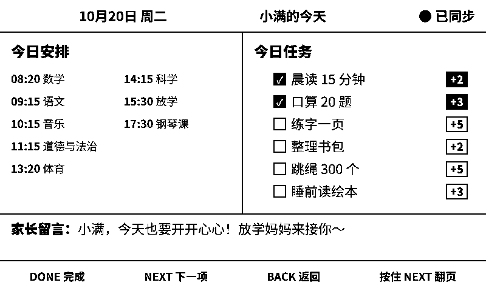
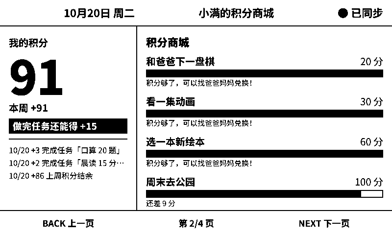
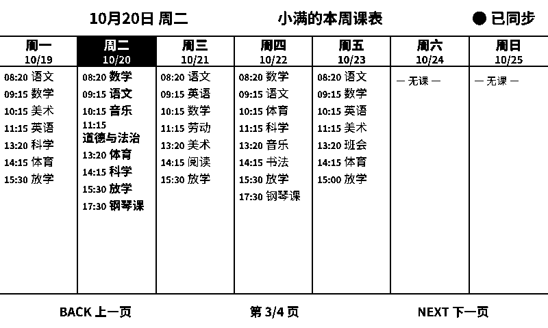
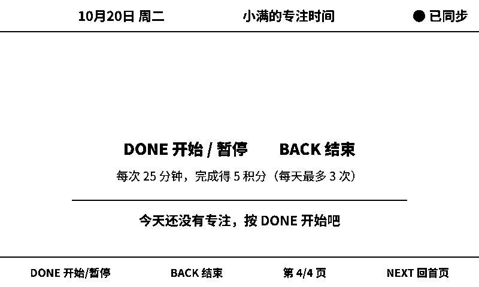
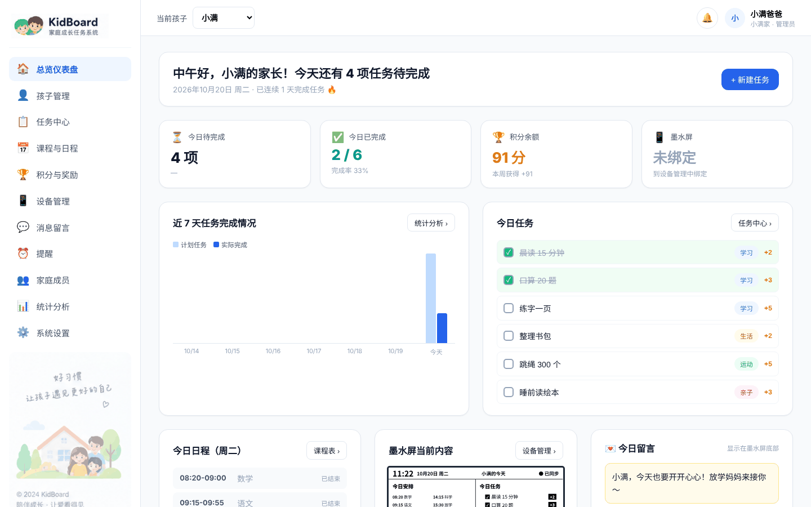

# KidBoard 墨水屏任务板

给孩子书桌用的一块墨水屏：今天的课程、任务、积分、心愿、专注计时和家长提醒，一屏看清。孩子做完一项，按一下绿键打勾，积分自动记上。家长在手机上的后台修改内容，屏幕定时同步。

这是一个个人项目，最初是给自家孩子做的，不提供一对一技术支持。欢迎提 issue，但不保证回复时间。

## 实际效果

以下截图用的是演示数据（虚构的孩子“小满”）。墨水屏截图直接取自服务端输出给设备的黑白点阵，和屏幕上显示的像素一致（左上角时钟由设备本地绘制，截图里是空的）。

| 首页 | 积分商城 |
|---|---|
|  |  |
| **本周课表** | **专注计时** |
|  |  |

家长后台：



更多后台截图见 [`docs/screenshots/`](docs/screenshots/)。

## 它由三部分组成

| 部分 | 做什么 | 代码位置 |
|---|---|---|
| 家长后台（网页） | 录课表、加任务、设积分和心愿、发提醒 | `apps/web` |
| 排版服务 | 把内容排成 800×480 的黑白图 | `apps/renderer`、`packages/screen-template` |
| 墨水屏固件 | 联网取图显示，处理按键 | `firmware`（ESP-IDF） |

屏幕不自己排版，只负责显示；日常通过 2.4 GHz Wi-Fi 同步，第一次配网时会开一个热点。断网时会一直显示最后一张画面。

## 硬件

| 方案 | 型号 | 说明 |
|---|---|---|
| 一体机（推荐） | Seeed reTerminal E1001 | ESP32-S3、7.5 寸黑白屏、3 个按键、蜂鸣器、电池、外壳，免接线。固件默认就是这个板型 |
| 散件 | ESP32-S3-DevKitC-1-N8R8 + Waveshare 7.5" e-Paper V2（黑白 800×480）+ 3 个轻触按钮 | 需要自己接线和做外壳，编译前在 `idf.py menuconfig` 里把板型改成 DevKitC |

散件默认接线（可在 menuconfig 里改）：

| 屏幕 | SCK | MOSI/DIN | CS | DC | RST | BUSY |
|---|---|---|---|---|---|---|
| ESP32-S3 GPIO | 12 | 11 | 10 | 9 | 8 | 7 |

按键：DONE = GPIO4，NEXT = GPIO5，BACK = GPIO6（按下接地）。接线前请对照你手上开发板的官方引脚图再核对一次。

## 快速开始

需要：一台常开的电脑或服务器（装 Docker）、上面任一硬件、一根 USB-C 数据线。

### 1. 启动服务

```bash
cp .env.example .env      # 然后编辑 .env
cd infra
docker compose --env-file ../.env -f docker-compose.yml up -d --build
```

打开 `http://localhost:3000`（端口取 `.env` 里的 `WEB_PORT`），注册第一个账号（即家庭管理员）。

`.env` 里要改的：

| 变量 | 说明 |
|---|---|
| `POSTGRES_PASSWORD` | 改成你自己的强密码 |
| `SESSION_SECRET` | **必填**，一串足够长的随机字符串（如 `openssl rand -hex 32`）。留空会使用代码里的默认值，别人可以伪造设备凭证 |
| `NEXT_PUBLIC_APP_URL` | 你的对外访问地址 |
| `QWEATHER_API_KEY` / `QWEATHER_API_HOST` | 可选，和风天气；不配就不显示天气 |

如果要放到公网（例如上班时用手机发提醒），请自行配置 HTTPS 反向代理，并建议只给家人开账号。

### 2. 编译并烧录固件

在 `firmware/` 下新建 `sdkconfig.defaults.local`（不会被提交），写上服务器地址：

```
CONFIG_KB_SERVER_URL="http://你的服务器IP:3000"
```

用 Docker 编译（不用在本机装 ESP-IDF）：

```bash
# 在仓库根目录执行；Windows Git Bash 前面加 MSYS_NO_PATHCONV=1
docker run --rm -v "$PWD:/src" -w /src/firmware espressif/idf:v6.1 idf.py build
# 打包出一个完整固件
docker run --rm -v "$PWD:/src" -w /src/firmware/build espressif/idf:v6.1 \
  bash -c 'esptool --chip esp32s3 merge-bin -o kidboard-full.bin @flash_args && cp kidboard_firmware.bin kidboard-app-0x20000.bin'
```

烧录（Chrome 网页烧录工具或 `esptool` 都可以，波特率用 115200）：

| 场景 | 文件 | 地址 |
|---|---|---|
| 第一次烧录 | `kidboard-full.bin` | `0x0` |
| 日常升级（保留 Wi-Fi 和配对） | `kidboard-app-0x20000.bin` | `0x20000` |
| 救砖（开不了机） | `build/bootloader/bootloader.bin` + `build/partition_table/partition-table.bin` + app | `0x0` + `0x8000` + `0x20000` |

```bash
esptool --chip esp32s3 -b 115200 write-flash 0x0 kidboard-full.bin
```

几个容易踩的坑：

- **文件和地址要一一对应。** 把错的文件写进 `0x0` 会导致开不了机，串口里会看到 `Invalid image block` 循环重启，用上表的救砖方法恢复。
- 连不上时按住 BOOT 再插 USB，进入下载模式。不要随手点 Erase，会清空 Wi-Fi 和配对。
- Windows / Mac 可能需要先装 CH340 串口驱动。
- 烧完看串口日志里的 `App version`，确认烧进去的是新版本。

### 3. 配网和配对

1. 设备开机后自动开热点 `KIDBOARD-XXXX`，手机连上（无密码）。
2. 在弹出的页面（或浏览器打开 `http://192.168.4.1`）选择家里的 2.4 GHz Wi-Fi 并输入密码。
3. 屏幕显示 6 位配对码，10 分钟内在后台“设备管理”输入，并选择孩子。

### 4. 在后台填内容

添加孩子（年级、作息）→ 录入周课表 → 添加任务和积分 → 设置心愿商城。没有墨水屏也可以用平板打开网页看板。

## 按键

从左到右：绿键 DONE、白键 NEXT、白键 BACK。

| 在哪 | 操作 | 效果 |
|---|---|---|
| 首页 | 短按 NEXT / BACK | 焦点框下移 / 上移 |
| 首页 | 短按 DONE | 完成当前任务，立即打勾 |
| 首页 | 按住 NEXT / BACK 1~5 秒 | 翻到第 2 页 / 最后一页 |
| 其他页 | 短按 NEXT / BACK | 下一页 / 上一页 |
| 专注页 | 短按 DONE | 开始 / 暂停 / 继续 |
| 专注页（计时中） | 短按 BACK | 结束计时（不计分） |
| 任意页 | 长按 BACK 5 秒，再按 DONE | 重新配网（换 Wi-Fi） |
| 任意页 | **长按 DONE 10 秒** | **立即恢复出厂**，清除 Wi-Fi 和配对，没有确认 |

## 注意事项

- 只支持 2.4 GHz Wi-Fi。
- 一体机内置电池，拔掉 USB 不会关机，要拨机身开关。
- 墨水屏翻页时闪几下是正常的。
- OTA 升级代码已写好，但没有在真机上验证过，目前请用 USB 烧录升级。

## 开发

```bash
pnpm install
pnpm typecheck
pnpm test
```

## 许可证

[Apache License 2.0](LICENSE)
